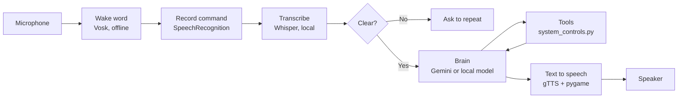

# Alfred: An Agentic Voice Assistant for Windows

Alfred is a voice assistant I built in Python that runs on my Windows PC. I say "Alfred", give a command in plain English, and it figures out what I want and does it: playing music, reading the news, adjusting the volume, taking screenshots, remembering things for me, or just answering a question.

## The basic idea

Voice commands are messy. People say "it's too loud", "put on something relaxing", or just "mute", and a fixed list of keyword rules can't cover all of that.

So Alfred is built around **function calling** (also called tool use) with a language model:

1. Every action Alfred can perform is a normal Python function with a docstring, such as `set_volume_percent(percent)` or `play_youtube(query)`.
2. These functions are given to the model as tools.
3. When I speak, the model reads the request, decides which tool (if any) to call and with which arguments, and that function runs.
4. The function's result goes back to the model, which replies in a short, natural sentence that Alfred speaks out loud.

So "it's too loud, bring it down a bit" becomes `change_volume_by(-15)`, without a single rule written for that sentence.

Alfred's "brain" can be either **Google Gemini** in the cloud or a **local model running on my own PC** through Ollama. Speech recognition runs locally with Whisper, and the wake word is detected offline with Vosk.

I also built an **evaluation suite** that measures how accurately Alfred hears and how accurately it picks actions, so I can compare models with real numbers instead of guessing.

## Features

- **Offline wake word**: Alfred listens for its name locally using Vosk. No audio leaves the PC while it waits.
- **Local speech recognition**: commands are transcribed on the PC with Whisper (via faster-whisper), which handles both full sentences and single words like "mute" or "news".
- **Two interchangeable brains**: Google Gemini (cloud) or a local model through Ollama, chosen with one setting. Both use the same tools.
- **Natural-language commands**: the model chooses the right tool from how I actually talk, not from fixed phrases.
- **Unclear-command handling**: if Whisper isn't confident about what it heard, Alfred asks me to repeat instead of guessing. Background noise is ignored, and the model is also instructed to ask again when a request is garbled or incomplete.
- **Media and web**: plays songs and videos on YouTube, reads the top news headlines, and opens websites.
- **System control**: sets or changes the volume, toggles mute, takes screenshots, reads the clipboard, and locks the PC.
- **Notes**: saves dictated notes with a timestamp to `notes.txt`.
- **Long-term memory**: if I say "remember my exam is on Friday", Alfred saves it to `memory.json` and still knows it after a restart.
- **Safety confirmation**: risky actions (currently locking the PC) ask "Are you sure?" first. The yes/no answer is recognized offline, and anything other than a clear yes, including "not sure" or silence, cancels the action.
- **Auto-sleep**: after a few silent turns, Alfred goes back to waiting for the wake word.
- **Date awareness**: Alfred knows today's date, so questions like "how many days until Friday?" work.
- **Evaluation suite**: scripts that score speech recognition and tool selection, and save detailed results.

## How it works



Step by step, this is what happens when I use Alfred:

1. **Passive mode.** `wake_word.py` keeps a small offline Vosk model listening for one word only: "alfred". Restricting the vocabulary to one word keeps it fast and light.
2. **Wake-up.** When it hears "Alfred", it releases the microphone and Alfred says "Yes?".
3. **Recording.** `main.py` records my command until I stop speaking for 1.3 seconds. It also keeps half a second of audio from just before I start talking, so the first word isn't cut off.
4. **Transcribing.** `transcriber.py` converts the recording to text locally with Whisper. A list of hotwords (like "PC", "YouTube" and "screenshot") nudges Whisper toward the words Alfred expects, but only when Whisper's voice detector confirms real speech, so background noise isn't turned into words.
5. **Checking confidence.** Whisper reports how sure it is. Silence and noise are ignored quietly, and uncertain speech makes Alfred say "Sorry, I didn't catch that" without sending anything to the brain.
6. **Local commands.** "Go to sleep" and "quit" are handled directly in `main.py`, because they control the program itself.
7. **Thinking.** Everything else goes to the brain in `ai_brain.py`, which keeps the conversation history, so follow-ups like "make it louder" work.
8. **Acting.** If the brain decides a tool is needed, the matching function in `system_controls.py` runs and its result goes back to the brain. Risky tools ask for a spoken yes/no confirmation first.
9. **Speaking.** The reply is converted to speech with gTTS and played with pygame, straight from memory without temporary files.
10. **Sleeping.** After I say "go to sleep", or after three silent listening turns, Alfred returns to passive mode.

## Evaluation results

I measured Alfred's two core skills on my own PC: **hearing** (speech recognition) and **deciding** (tool selection).

### Tool selection: does the brain choose the right action?

38 typed commands, each with the correct tool, covering direct commands ("set the volume to 40"), indirect ones ("it's too loud"), general questions that need no tool ("what is recursion"), and garbled or incomplete input that should be refused ("banana", "set the volume to"). No tools actually run during this test; it only records which tool the model would choose.

| Brain | Correct tool | Median time per decision |
|---|---|---|
| Gemini (gemini-3.5-flash-lite, cloud) | 38/38 (100%) | 0.96 s |
| qwen2.5:3b (local, via Ollama) | 33/38 (87%) | 1.86 s |

| Category | Gemini | qwen2.5:3b |
|---|---|---|
| System (lock, screenshot, clipboard) | 7/7 | 7/7 |
| Volume | 7/7 | 5/7 |
| Media (YouTube, news) | 7/7 | 4/7 |
| Web | 3/3 | 3/3 |
| Notes | 2/2 | 2/2 |
| Memory | 4/4 | 4/4 |
| General questions | 4/4 | 4/4 |
| Unclear input | 4/4 | 4/4 |

**What this shows:**

- The local model handles **direct** commands perfectly but struggles with **indirect** ones. All 5 of its misses were requests that don't name the action: "it's too loud", "make it quieter", "put on something relaxing", "news", and "what's happening in the world today". Inferring intent is where a small 3B model falls behind a larger cloud model.
- **Every local-model mistake was a safe one.** In all 5 cases it did nothing rather than the wrong thing, and it refused all garbled input correctly. For a voice assistant, failing safely matters more than failing rarely.
- The local model is about twice as slow on my PC and phrases tool arguments less cleanly (for example, saving a fact as "I remember you like dark chocolate"), but it's free, private, works offline, and has no daily limit.

### Speech recognition: does Alfred hear correctly?

30 recordings of my own voice: 24 in a quiet room and 6 with background music. They include single words ("mute"), short commands, and long sentences. Word error rate (WER) is the percentage of words that were wrong, missing, or extra; lower is better.

| Whisper model | Word error rate | Quiet | Noisy | Exactly right | Median time per clip |
|---|---|---|---|---|---|
| base.en | 8.4% | 7.1% | 15.0% | 21/30 | 0.70 s |
| small.en | 3.4% | 3.0% | 5.0% | 26/30 | 2.06 s |

**What this shows:**

- `small.en` makes less than half the errors of `base.en`, and is three times more robust to background noise.
- The **type** of error matters more than the count. `base.en` made mistakes that change the action, like "lock my TV", "open your top" (for "open github") and "Quick!" (for "quit"). `small.en`'s remaining mistakes were mostly harmless, like "band" instead of "bank".
- `small.en` is about three times slower, but 2 seconds is acceptable for a voice assistant, so I use `small.en` by default.
- Times are medians: a few clips took much longer while my PC was busy with other work, and the median isn't distorted by those spikes.
- Two clips were misheard by both models in the same way, which points to the recording rather than the model: the first word of "remember my exam is on friday" was missing (likely clipped at the start), and "go to sleep" was heard as "go to see".

### Running the evaluation yourself

```
python evaluation/eval_tools.py          # tests whichever brain BRAIN in .env selects
python evaluation/record_clips.py        # records your own voice clips (one time)
python evaluation/eval_speech.py         # compares base.en and small.en on your clips
```

Detailed results for every command and clip are saved as CSV files in `evaluation/results/`.

## Project structure

```
alfred/
├── main.py              # Main loop: wake word, recording, confirmations, speaking
├── ai_brain.py          # Gemini and local brains, system prompt, tool registration
├── transcriber.py       # Local speech-to-text with Whisper, plus confidence checks
├── wake_word.py         # Offline wake word and yes/no detection with Vosk
├── system_controls.py   # Every tool Alfred can use, plus memory and the confirmation decorator
├── evaluation/
│   ├── tool_cases.csv       # Commands and the tool each one should trigger
│   ├── eval_tools.py        # Scores the brain's tool choices
│   ├── speech_cases.csv     # Sentences to record, with the exact expected text
│   ├── record_clips.py      # Records the voice clips
│   ├── eval_speech.py       # Scores Whisper's accuracy and speed
│   ├── audio/               # Recorded clips
│   └── results/             # Detailed results from each run
├── requirements.txt     # Libraries Alfred needs
├── .env.example         # Template for API keys and settings
└── .gitignore
```

Files Alfred creates while running (ignored by Git): `memory.json`, `notes.txt`, and the `screenshots/` folder.

## Requirements

- Windows 10 or 11 (locking the PC and volume control use Windows APIs)
- Python 3.10 or newer, 64-bit
- A microphone and speakers
- An internet connection (for Gemini, text to speech, and news)
- About 600 MB of free disk space for the speech models
- A free Gemini API key from [Google AI Studio](https://aistudio.google.com/)
- A free News API key from [NewsAPI](https://newsapi.org/) (optional, only needed for news)
- For the local brain (optional): [Ollama](https://ollama.com), about 2 GB of disk space, and about 4 GB of free RAM

## Setup

1. **Clone the repository**
```
   git clone <your-repo-url>
   cd alfred
```

2. **Create and activate a virtual environment**
```
   python -m venv .venv
   .venv\Scripts\activate
```
   You should see `(.venv)` at the start of your terminal line.

3. **Install the dependencies**
```
   pip install -r requirements.txt
```
   If `PyAudio` fails to install, make sure you're on 64-bit Python 3.10+ with an up-to-date pip (`python -m pip install --upgrade pip`), then try again.

4. **Add your API keys and settings**

   Copy the template:
```
   copy .env.example .env
```
   Then open `.env` and fill it in:
```
   BRAIN=gemini
   GEMINI_API_KEY=your_gemini_api_key_here
   GEMINI_MODEL=gemini-3.5-flash-lite
   LOCAL_MODEL=qwen2.5:3b
   NEWS_API_KEY=your_newsapi_key_here
   NEWS_COUNTRY=us
   WHISPER_MODEL=small.en
   WHISPER_DEVICE=cpu
```

5. **Optional: set up the local brain**

   Install [Ollama](https://ollama.com), then download the model (about 2 GB, one time):
```
   ollama pull qwen2.5:3b
```
   Then set `BRAIN=local` in `.env`.

### Settings explained

| Setting | What it does |
|---|---|
| `BRAIN` | `gemini` for the cloud brain, or `local` for the Ollama model |
| `GEMINI_API_KEY` | Your Gemini API key (needed for `BRAIN=gemini`) |
| `GEMINI_MODEL` | Which Gemini model to use. Flash-Lite models have higher free daily limits |
| `LOCAL_MODEL` | Which Ollama model to use for `BRAIN=local` |
| `NEWS_API_KEY` | Your NewsAPI key (optional) |
| `NEWS_COUNTRY` | Two-letter country code for headlines, like `us` or `gb` |
| `WHISPER_MODEL` | Speech model. `small.en` is more accurate; `base.en` is about 3 times faster (see the evaluation results) |
| `WHISPER_DEVICE` | `cpu` works everywhere. `cuda` uses an NVIDIA GPU, but needs CUDA installed |

## How to run

```
python main.py
```

The first run downloads the speech models, which happens once and is cached afterwards:

- The Vosk wake-word model (about 40 MB)
- The Whisper `small.en` model (about 500 MB)

When it starts, the terminal shows:

```
[System] AI brain: gemini (gemini-3.5-flash-lite)
[System] Loading Whisper model 'small.en'...
[System] Calibrating microphone for room noise, please stay quiet...
[Alfred]: Alfred is online. Say Alfred when you need me.

[Passive] Waiting for the wake word...
```

Stay quiet for the one-second calibration so Alfred can measure the background noise. Then:

1. Say **"Alfred"**.
2. Wait until Alfred finishes saying **"Yes?"**.
3. Give your command. You can give several commands in a row without saying "Alfred" again.

When Alfred asks a yes/no question, wait for `[Confirm] Say yes or no...` in the terminal before answering.

To stop Alfred, say **"quit"** or press `Ctrl + C` in the terminal.

## Example commands

| What I say | What Alfred does |
|---|---|
| "Alfred" | Wakes up and replies "Yes?" |
| "Play Shape of You" | Plays it on YouTube |
| "Put on something relaxing" | Picks and plays relaxing music on YouTube |
| "News" | Reads the top 3 headlines |
| "Open GitHub" | Opens github.com in the browser |
| "Set the volume to 40" | Sets system volume to 40% |
| "It's too loud" | Lowers the volume |
| "Mute" | Toggles mute |
| "Screenshot" | Saves a screenshot in `screenshots/` |
| "Read my clipboard" | Reads the copied text aloud |
| "Make a note to call the bank tomorrow" | Saves it to `notes.txt` |
| "Remember my exam is on Friday" | Saves it to long-term memory |
| "What do you remember about me?" | Reads back saved memories |
| "Forget about the exam" | Deletes matching memories |
| "Lock my PC" | Asks for confirmation, then locks |
| "What is recursion?" | Answers the question |
| "Go to sleep" | Returns to wake-word mode |
| "Quit" | Shuts Alfred down |

## Manual tests

I use these to check that everything works after making changes. Start Alfred with `python main.py` and go through the list.

| # | What to do | Expected result |
|---|---|---|
| 1 | Say "Alfred" | Says "Yes?" |
| 2 | Say a sentence without "Alfred" while in passive mode | Nothing happens |
| 3 | Say "Play lo-fi music" | YouTube opens and starts playing |
| 4 | Say "Put on something relaxing" | Plays something on YouTube even without the word "play" |
| 5 | Say "Mute" | Mutes (single word understood) |
| 6 | Say "News" | Reads 3 headlines (single word understood) |
| 7 | Say "Open Wikipedia" | Opens Wikipedia |
| 8 | Say "Set the volume to 30", then "make it a bit louder" | Volume goes to 30%, then higher (conversation memory works) |
| 9 | Say "Banana" or mumble something | Asks you to repeat, performs no action |
| 10 | Say "Lock my PC", answer "no" | Says it was cancelled, PC stays unlocked |
| 11 | Say "Lock my PC", answer "I'm not sure" | Cancelled, PC stays unlocked |
| 12 | Say "Lock my PC", answer "yes" | PC locks |
| 13 | Say "Lock my PC", stay silent | Cancelled after about 6 seconds |
| 14 | Copy a sentence, say "Read my clipboard" | Reads the copied text |
| 15 | Say "Take a screenshot" | New image appears in `screenshots/` |
| 16 | Say a long sentence with a short pause in the middle | The whole sentence is captured |
| 17 | Say "Remember my exam is on Friday", say "quit", restart, then ask "When is my exam?" | Answers Friday (memory survives restart) |
| 18 | Say "Forget about the exam", then ask "When is my exam?" | Says it doesn't know |
| 19 | Stay silent in active mode | No random text appears; goes back to passive mode after a few turns |
| 20 | Say "Go to sleep" | Says "Going to sleep." and waits for the wake word |
| 21 | Say "Quit" | Says goodbye and the program exits |
| 22 | Set `BRAIN=local`, restart, and repeat tests 5–8 | Same behaviour using the local model |

## Adding a new tool

Adding a new ability takes three steps:

1. Write a function in `system_controls.py` with type hints and a clear docstring. The model reads the docstring to understand when to use the tool, so it matters.
```python
   def get_battery_level() -> str:
       """Returns the laptop's current battery percentage."""
       ...
```
2. Add it to the `TOOLS` list in `ai_brain.py`. Both brains pick it up automatically.
3. If the action is risky, add the confirmation decorator so Alfred asks first:
```python
   @requires_confirmation("Are you sure you want me to close all windows?")
   def close_all_windows() -> str:
       """Closes all open application windows."""
       ...
```

If the new tool uses a word Whisper might mishear, add it to `HOTWORDS` in `transcriber.py`. Then add a few test commands for it to `evaluation/tool_cases.csv` and re-run the evaluation.

## Troubleshooting

| Problem | Fix |
|---|---|
| `GEMINI_API_KEY is missing` on startup | The `.env` file is missing or the key name is misspelled |
| Alfred says "I've used up my AI quota" | The daily free limit for that model is reached. Try again later, set a different `GEMINI_MODEL`, or use `BRAIN=local` |
| Alfred says "I couldn't reach my AI service" | Check your internet connection, API key and model name; the terminal shows the exact error |
| `Could not load local model` on startup | Make sure the Ollama app is running and you ran `ollama pull` for the model in `LOCAL_MODEL` |
| The first local command takes 20+ seconds | Normal: the model is loading into memory. Later commands are much faster |
| `ollama` is not recognized in the terminal | Open a new terminal after installing Ollama |
| Transcribing takes several seconds | Set `WHISPER_MODEL=base.en` in `.env` (faster but less accurate) |
| The first word of a command is missing | Wait until Alfred has fully finished saying "Yes?" before speaking |
| Alfred keeps saying "Sorry, I didn't catch that" | Speak a little closer to the mic, or reduce background noise and restart so it recalibrates |
| Alfred never wakes up | Check that the microphone is the Windows default input device |
| Alfred wakes up on similar-sounding words | Normal with a one-word vocabulary; move the mic further from speakers |
| News says "Could not fetch the news" | Check `NEWS_API_KEY`, or that NewsAPI is reachable |

## What I learned

The most useful bug I hit was that every Gemini request failed instantly with "timed out". The Google GenAI SDK's `HttpOptions.timeout` is measured in **milliseconds**, not seconds, so `timeout=30.0` gave each request just 30 ms. Changing it to `30_000` fixed it, and since then I always check units in API docs before assuming.

Measuring Alfred changed how I think about AI systems. Before the evaluation, both Whisper models "seemed fine" when I tried them; the numbers showed one makes less than half the errors of the other, and that the **kind** of error (harmless vs action-changing) matters as much as how many there are. Comparing brains showed that a small local model is reliable on direct commands but weaker at inferring intent, which is exactly the kind of trade-off I'd want to know before choosing a model.

Building Alfred also taught me how function calling works in practice, how to design tools so a language model uses them correctly (clear names and docstrings matter a lot), how to use speech recognition confidence so the assistant doesn't act on guesses, and how to keep risky actions behind a confirmation step. Errors inside tools are also easy to miss, because they're passed to the model instead of crashing, so printing them clearly saved me a lot of debugging time.

## Future improvements

- Make the "go to sleep" and "quit" commands tolerant of small mishearings (like "go to see")
- Tune the system prompt for the local model to improve its handling of indirect requests, and measure the change
- Add harder and more varied test cases, including more noisy recordings and other speakers
- A more natural, faster voice for replies
- Interrupting Alfred while it's speaking
- More tools: opening apps, timed reminders, weather, battery status
- A small desktop GUI or system tray icon showing Alfred's status
- Packaging Alfred as a standalone `.exe`

## License

This project is licensed under the MIT License.